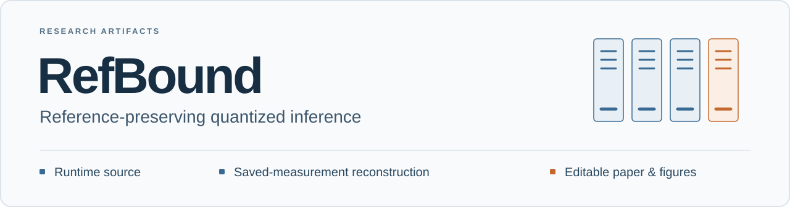

<p align="center">
  
</p>

<p align="center">
  <a href="https://arxiv.org/abs/2610.03228"><strong>Paper</strong></a> ·
  <a href="#quick-start"><strong>Quick start</strong></a> ·
  <a href="docs/README.md"><strong>Artifact guide</strong></a> ·
  <a href="docs/EVIDENCE_MAP.md"><strong>Evidence map</strong></a> ·
  <a href="#citation"><strong>Citation</strong></a>
</p>

**Source and evidence for reference-preserving quantized inference.**

Research companion to [*Recovering Parallelism under Fixed Numerical References in Quantized LLM Decoders*](https://arxiv.org/abs/2610.03228), by Chengzhan Li.

RefBound brings together the P4 numerical core and application frontend, statistical reconstruction from saved measurements, and editable figures and a frozen manuscript. Each workflow has its own inputs, checks and recorded scope.

## Choose a starting point

| You want to… | Start here | What you get |
| --- | --- | --- |
| **Inspect the implementation** | [Runtime source](runtime/README.md) | P4 backend and frontend, CPU build, state tests and CUDA build stages |
| **Check the reported numbers** | [Statistical reconstruction](reproduce/README.md) | Saved A5000/RTX estimates and specified intervals, M1 and historical point estimates |
| **Edit the figures or paper** | [Paper reconstruction](paper/README.md) | 8 editable figures, 27 native tables and the bundled 33-page manuscript |
| **Trace a claim to its inputs** | [Evidence map](docs/EVIDENCE_MAP.md) | Paper anchors, released datasets and reconstructed output fields |

## Quick start

Start with the saved-measurement reconstruction. It runs on the CPU with Python and NumPy.

```sh
git clone https://github.com/leecdiang/RefBound.git
cd RefBound
python3 -m venv .venv
source .venv/bin/activate
python -m pip install -r reproduce/requirements.txt
python verify.py
python reproduce/scripts/reproduce.py
```

On Windows PowerShell, activate with `.venv\Scripts\Activate.ps1` instead. The statistics workflow was tested with **Python 3.12 and NumPy 2.3.5**. Run without `-O`, `-OO` or `PYTHONOPTIMIZE` so scientific verification remains enabled.

The result is written to `reproduce/results/recomputed.json`. A successful run prints `PASS` and the maximum difference from the frozen reference values. The script checks input hashes, sampling units and expected numerical results; the [scope guide](reproduce/SCOPE.md) identifies which intervals are recomputed.

<details>
<summary><strong>Build the CPU source or regenerate the paper</strong></summary>

Install the dependencies in the linked component guide, then run from the repository root:

```sh
# CMake, Ninja, a C++17 compiler and OpenMP
python3 runtime/scripts/build_cpu.py --out /absolute/path/to/new-cpu-build --jobs 2

# Plotting dependencies, pypdf, and TeX Live with the required fonts
python3 paper/build.py --output /absolute/path/to/new-paper-build
```

These two output directories must be new and outside the repository. The statistics command above uses its fixed, ignored output path inside `reproduce/results/`.

</details>

## What the release verifies

| Workflow | Recorded check | Details |
| --- | --- | --- |
| **Statistics** | Frozen-input and reference checks for A5000/RTX, 27 historical contrasts, 474 root estimates and M1 point estimates | [Results and units](reproduce/README.md#results-and-units) |
| **CPU source** | 216 core build steps, actual P4 frontend object compilation, transaction checks and 257,082 draft-work cases | [Validation record](runtime/VALIDATION.json) |
| **Figures and paper** | 8 figure PDFs and 27 tables match the bundled exhibits byte for byte; the builder produces 33 pages | [Paper guide](paper/README.md) |
| **File integrity** | Byte counts and SHA-256 hashes for all manifest-listed release files | [`verify.py`](verify.py) |

The public runtime contains the P4 application frontend; the later LOCAL diagnostic frontend has its own implementation and qualification records. CUDA execution requires the deployment-specific build and numerical checks described in [CUDA_BUILD.md](runtime/CUDA_BUILD.md). Statistics and graphics reconstruct saved measurements; model weights, original prompts and full numerical-state captures are outside this distribution.

> **Bundled manuscript.** `paper/build.py` targets the frozen **33-page** artifact manuscript, with **8 figures and 27 tables**. The [arXiv record](https://arxiv.org/abs/2610.03228) is the public paper entry point. Updating repository documentation does not change either manuscript.

## Documentation and contributions

- [Artifact guide](docs/README.md): workflows, version scope and historical provenance.
- [Evidence map](docs/EVIDENCE_MAP.md): follow a result from the manuscript to the public inputs.
- [Contributing](CONTRIBUTING.md): report a problem, propose a correction and maintain file identities.
- [Open an issue](https://github.com/leecdiang/RefBound/issues/new/choose): build/reconstruction reports and documentation feedback.

## Citation

Please cite the paper and identify the RefBound commit used. Machine-readable metadata is available in [CITATION.cff](CITATION.cff).

<details>
<summary><strong>BibTeX</strong></summary>

```bibtex
@misc{li2026refbound,
  author        = {Chengzhan Li},
  title         = {Recovering Parallelism under Fixed Numerical References in Quantized LLM Decoders},
  year          = {2026},
  eprint        = {2610.03228},
  archivePrefix = {arXiv},
  url           = {https://arxiv.org/abs/2610.03228}
}
```

</details>

## License

Author software is **MIT**; author-owned text, figures and released data are **CC BY 4.0**. Third-party components retain their own terms. See [LICENSE.md](LICENSE.md) for the component-level scope and notices.
